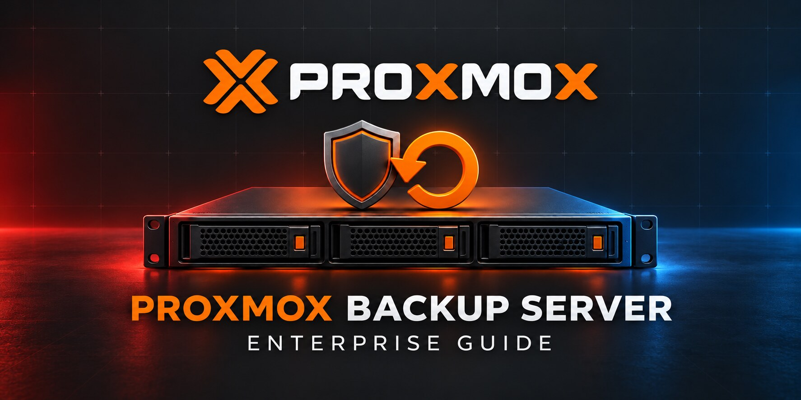

# Proxmox Backup Server Enterprise Guide

<p align="center">
  
</p>


[](https://github.com/sarabelinformatika/proxmox-backup-server-enterprise-guide/releases)
[](LICENSE)

A production-oriented design, security, recovery, and operating guide for Proxmox Backup Server (PBS). It covers sizing, storage, ZFS, datastore layout, Proxmox VE integration, retention, prune, garbage collection, verification, off-site synchronization, encryption, ransomware resistance, monitoring, tape, restore testing, and incident response.

This independent guide is published by [SARABEL Informatika Kft.](https://sarabelinformatika.hu). It complements the SARABEL [Hyper-V to Proxmox Migration Guide](https://github.com/sarabelinformatika/hyper-v-to-proxmox-migration-guide) and the other infrastructure guides maintained by the organization.

> A completed backup job is not proof of recoverability. Enterprise acceptance requires verified backup data, protected credentials, isolated copies, documented recovery objectives, and repeated restore tests.

## Reference architecture

| Layer | Typical components | Primary objective |
|---|---|---|
| Workloads | Proxmox VE clusters, Linux hosts | Consistent, scheduled backups |
| Backup fabric | Dedicated VLAN, DNS, NTP, firewall | Restricted and observable traffic |
| Primary PBS | Separate physical server, mirrored boot | Fast operational recovery |
| Datastore | ZFS mirror/RAIDZ or validated storage | Integrity, capacity, predictable latency |
| Off-site PBS | Pull sync over controlled link | Fault-domain and ransomware separation |
| Offline tier | LTO/WORM or disconnected media | Recovery after administrative compromise |
| Operations | Monitoring, ticketing, recovery records | Evidence, alerting, ownership |

## Guide map

1. [Scope, objectives, and threat model](docs/01-scope-objectives-and-threat-model.md)
2. [Discovery, RPO/RTO, sizing, and licensing](docs/02-discovery-rpo-rto-sizing-and-licensing.md)
3. [Reference architecture and failure domains](docs/03-reference-architecture-and-failure-domains.md)
4. [Hardware, installation, repositories, and lifecycle](docs/04-hardware-installation-repositories-and-lifecycle.md)
5. [Storage, ZFS, datastores, and capacity](docs/05-storage-zfs-datastores-and-capacity.md)
6. [Network, DNS, NTP, TLS, and firewall](docs/06-network-dns-ntp-tls-and-firewall.md)
7. [Identity, roles, API tokens, and MFA](docs/07-identity-roles-api-tokens-and-mfa.md)
8. [Proxmox VE integration and backup jobs](docs/08-proxmox-ve-integration-and-backup-jobs.md)
9. [Retention, prune, garbage collection, and protection](docs/09-retention-prune-garbage-collection-and-protection.md)
10. [Verification, integrity, and restore testing](docs/10-verification-integrity-and-restore-testing.md)
11. [Off-site sync, namespaces, and multi-tenancy](docs/11-offsite-sync-namespaces-and-multitenancy.md)
12. [Encryption and key management](docs/12-encryption-and-key-management.md)
13. [Ransomware resistance and privileged recovery](docs/13-ransomware-resistance-and-privileged-recovery.md)
14. [Monitoring, alerting, reporting, and capacity](docs/14-monitoring-alerting-reporting-and-capacity.md)
15. [Tape, offline copies, and long-term retention](docs/15-tape-offline-and-long-term-retention.md)
16. [Deployment, acceptance, incident response, and operations](docs/16-deployment-acceptance-incident-response-and-operations.md)

## Included operational material

- Four read-only shell assessment scripts
- Example architecture, retention, and monitoring YAML files
- Security, command, port, limitation, and source references
- Deployment, change, access, recovery-test, acceptance, and incident templates
- GitHub Actions validation for Markdown links, YAML, shell syntax, and secret patterns

## Safe-use principles

- Run assessment scripts read-only first and review their output.
- Never place passwords, API-token secrets, or encryption keys in Git.
- Keep PBS administration off the public Internet.
- Use a separate failure domain; do not treat storage inside the protected PVE cluster as the only backup.
- Test restore procedures using representative virtual machines, containers, and files.

## Quick start

```bash
git clone https://github.com/sarabelinformatika/proxmox-backup-server-enterprise-guide.git
cd proxmox-backup-server-enterprise-guide
chmod +x scripts/*.sh
sudo ./scripts/pbs-host-assessment.sh
./scripts/pbs-datastore-health.sh
```

Review [SECURITY.md](SECURITY.md), [DISCLAIMER.md](DISCLAIMER.md), and [reference/limitations.md](reference/limitations.md) before production changes.

## Trademark notice

Proxmox and Proxmox Backup Server are trademarks of Proxmox Server Solutions GmbH. This independent project is not an official Proxmox publication and is not endorsed by Proxmox Server Solutions GmbH.

## License

Released under the [MIT License](LICENSE).
